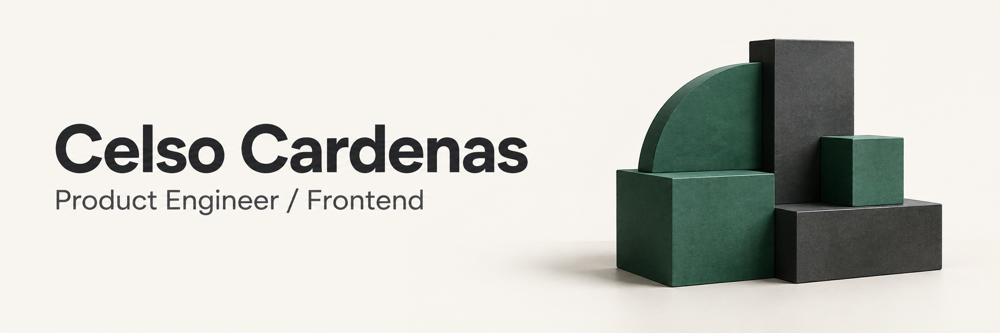

<picture>
  <source media="(prefers-color-scheme: dark)" srcset="./assets/header-dark.png">
  <source media="(prefers-color-scheme: light)" srcset="./assets/header-light.png">
  
</picture>

# Hi, I'm Celso.

**I'm a frontend engineer who cares about the whole product.**

I build web applications with **React, Next.js, and TypeScript**. My work spans UI architecture, performance, testing, and the integrations that make a feature useful beyond the screen.

[Let's connect on LinkedIn](https://www.linkedin.com/in/celso-cardenas/)

## What I've worked on

- **Web applications:** building interfaces, improving performance, and keeping frontend code testable as products grow.
- **Tools for other developers:** publishing open-source packages and building embeddable widgets adopted by external partners.
- **Web3 integrations:** connecting frontend experiences with services and workflows beyond the application itself.

## How I approach the work

I like understanding what a feature needs to do for the person using it, then working through the details that make it reliable. Clear interfaces, thoughtful architecture, and useful tests all matter to me.

My core stack is **React / Next.js / TypeScript**. Depending on the project, I also work with GraphQL, React Query, React Hook Form, and Tailwind CSS.

## Beyond the code

I enjoy sharing what I learn and talking about building software. You can also find me on [YouTube](https://www.youtube.com/@UnaDailyM%C3%A1s) and [Instagram](https://www.instagram.com/cecam3_/).
